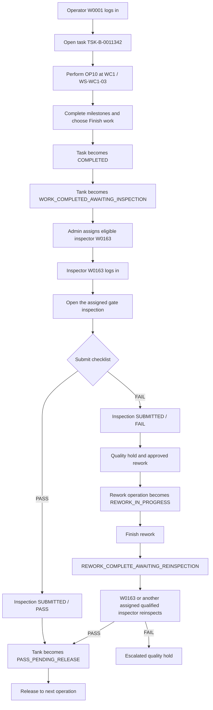
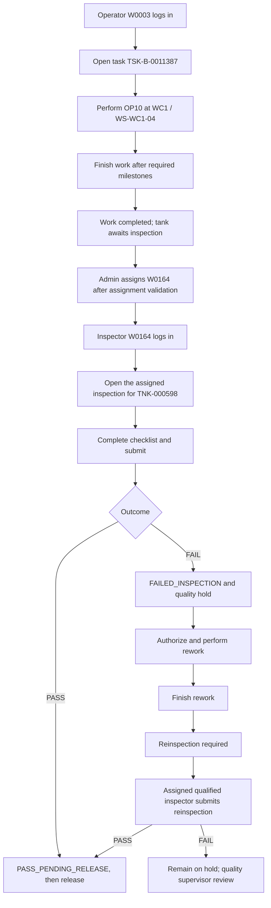
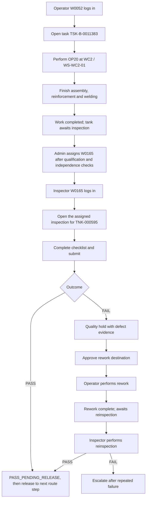

# Client Demo: Operator-to-Inspector Workflow

## Purpose

This document defines a verified client demonstration for moving work from an operator through completion, inspection, possible rework, and reinspection.

All data is synthetic demonstration data. It is not connected to a real factory or Siemens system.

## Verified live snapshot

- Session: `S-005A77` — Demo shift (default)
- Mode: Synthetic interactive demo
- Checkpoint: `CK-20261015-1055`
- Current simulation state: paused at `2026-10-15 10:55:01` America/Bogota
- Workers currently in `WORKING`: 31
- People with active tasks at initialization: 62
- Open inspections at the snapshot: 2
- Database: `gini_demo_dev`

The three operators below are distinct operators on distinct active operations. Their current assignments were read from the live application API.

## Operator mapping

| Operator | Name | Operation | Work center | Workstation | Tank | Task | Operation instance | Current status | Progress |
|---|---|---|---|---|---|---|---|---|---:|
| `W0001` | James Miller | `OP10` — Shell fit-up and pre-assembly | `WC1` | `WS-WC1-03` | `TNK-000597` | `TSK-B-0011342` | `OPI-B-0005365` | `WORKING` | 97.94% |
| `W0003` | Daniel Lewis | `OP10` — Shell fit-up and pre-assembly | `WC1` | `WS-WC1-04` | `TNK-000598` | `TSK-B-0011387` | `OPI-B-0005373` | `WORKING` | 76.13% |
| `W0052` | Laura Watson | `OP20` — Assembly, reinforcement and welding | `WC2` | `WS-WC2-01` | `TNK-000595` | `TSK-B-0011383` | `OPI-B-0005390` | `WORKING` | 24.59% |

### Inspector assignment status

The selected operations are still `WORKING`. Therefore, the application has not yet created an inspector assignment for these three tanks. The correct value in the assignment column is **Pending — not assigned**, not an invented inspector ID.

The following inspector accounts are verified active, clocked in, waiting, and qualified for `SK-INSP` (CTQ inspection). They are suitable candidates for assignment after the corresponding operator completes work:

| Candidate inspector | Name | Role | Attendance | Activity | Qualification | PIN |
|---|---|---|---|---|---|---:|
| `W0163` | Jonathan Boyd | `QUALITY_INSPECTOR` | `CLOCKED_IN` | `WAITING` | `SK-INSP`, qualified | `818435` |
| `W0164` | Katherine Jones | `QUALITY_INSPECTOR` | `CLOCKED_IN` | `WAITING` | `SK-INSP`, qualified | `794359` |
| `W0165` | Jacob Scott | `QUALITY_INSPECTOR` | `CLOCKED_IN` | `WAITING` | `SK-INSP`, qualified | `660181` |

These are **eligible candidates**, not current assignments. Assignment should be made in the admin application after each tank reaches `WORK_COMPLETED_AWAITING_INSPECTION`.

## Mapping table for the client demonstration

| Operator ID | Operation | Work center | Current status | Assigned inspector ID | Inspection status |
|---|---|---|---|---|---|
| `W0001` | `OP10` — Shell fit-up and pre-assembly on `TNK-000597` | `WC1` | `WORKING` | **Pending — not assigned**; candidate `W0163` | Not yet created |
| `W0003` | `OP10` — Shell fit-up and pre-assembly on `TNK-000598` | `WC1` | `WORKING` | **Pending — not assigned**; candidate `W0164` | Not yet created |
| `W0052` | `OP20` — Assembly, reinforcement and welding on `TNK-000595` | `WC2` | `WORKING` | **Pending — not assigned**; candidate `W0165` | Not yet created |

The candidate pairing above is a proposed demo allocation based on current availability. It becomes a verified assignment only after an administrator executes `INSPECTION_ASSIGN` for the completed tank.

## Flowchart 1 — W0001 / TNK-000597 / WC1

## Flowchart 2 — W0003 / TNK-000598 / WC1

## Flowchart 3 — W0052 / TNK-000595 / WC2

## Existing open-inspection proof

The live application already contains two open inspection tasks that demonstrate the inspector workflow:

| Inspection | Tank | Gate | Inspector | Status | Verified login access |
|---|---|---|---|---|---|
| `INS-B-002395` | `TNK-000584` | `QG30` | `W0161` — Ryan Bell | `DRAFT` | W0161 login returned HTTP 200 |
| `INS-005A77-00001` | `TNK-000600` | `QG10` | `W0162` — Melissa Hayes | `DRAFT` | W0162 login returned HTTP 200 |

Credentials for this proof are in [`LOGIN_CREDENTIALS.txt`](LOGIN_CREDENTIALS.txt): W0161 / `558851` and W0162 / `155660`.

## Step-by-step client demo script

### Part A — show the three operators

1. Open the admin application at `http://localhost:5174`.
2. Sign in as `admin` using the password in `backend/.env`.
3. Keep the simulation paused initially so the snapshot remains stable.
4. Open Workforce and show:
   - W0001 James Miller — WC1 — OP10 — `WORKING`.
   - W0003 Daniel Lewis — WC1 — OP10 — `WORKING`.
   - W0052 Laura Watson — WC2 — OP20 — `WORKING`.
5. Open each worker detail to show the task ID, tank, workstation, and operation instance.

### Part B — demonstrate completion and assignment

1. Use the operator login for one selected operator.
2. Open the current task and demonstrate the task details and milestones.
3. Finish the operation. The expected transition is:
   `WORKING` → `COMPLETED` task → `WORK_COMPLETED_AWAITING_INSPECTION` tank.
4. Return to the admin application and assign one waiting, qualified inspector.
5. Record the assignment in the mapping table. Until this step, the inspector ID remains pending.

### Part C — demonstrate inspection

1. Sign out of the operator account.
2. Sign in as the assigned inspector using the inspector ID and PIN from the credentials file.
3. Open the assigned inspection, complete the checklist, and submit a passing result.
4. Show that the inspection is `SUBMITTED` with result `PASS` and the tank is ready for release.
5. For the failure branch, submit a failed checklist using a realistic defect answer. Show the quality hold, approved rework, rework completion, reinspection, and final pass or escalation.

### Part D — prove isolation

1. Leave W0003's task unchanged while completing W0001's inspection.
2. Confirm W0003 remains `WORKING` and its task ID and operation instance are unchanged.
3. Confirm an inspector cannot start an inspection for a tank assigned to another inspector; the command layer returns an `INSPECTOR_ASSIGNED` conflict.
4. Confirm an inspector who was part of the production crew cannot independently approve that same work; the command layer rejects the action.

## Validation results and known gap

### Verified

- Three distinct operators with current `WORKING` assignments were identified from the live API.
- Their names, work centers, workstations, tanks, operations, task IDs, and operation instances were verified.
- W0163, W0164, and W0165 are active, clocked in, waiting, and qualified for `SK-INSP`.
- Existing assigned inspections can be opened by their assigned inspector accounts.
- The command workflow validates that a tank must be inspection-ready before assignment.
- Assignment validates active inspector role, required skill, and independence from the production crew.
- Inspection start validates assignment, attendance, qualification, workload, scan requirements where enabled, and independence.
- PASS moves the flow toward release; FAIL creates a quality-hold/rework path; rework completion requires reinspection.

### Gap to call out during the demo

The selected three operators are currently still working, so there is no real inspector assignment to report yet. Do not present W0163/W0164/W0165 as assigned until the completion and assignment steps are executed.

The read-only inspection-detail endpoint currently allows any account with the quality-inspection permission to view an inspection detail, even when another inspector is named on the inspection. The write path is stricter: starting or submitting work checks assignment and independence. If the client requires strict read-only visibility as well, the endpoint should be tightened to allow the named inspector, quality supervisors, and explicitly authorized admin users only.

## Credentials used in this document

Only the relevant demo accounts are listed here:

| Account | Login ID | PIN |
|---|---|---:|
| Operator — James Miller | `W0001` | `784645` |
| Operator — Daniel Lewis | `W0003` | `861763` |
| Operator — Laura Watson | `W0052` | `269587` |
| Candidate inspector — Jonathan Boyd | `W0163` | `818435` |
| Candidate inspector — Katherine Jones | `W0164` | `794359` |
| Candidate inspector — Jacob Scott | `W0165` | `660181` |

These are local synthetic-demo credentials. Keep this document private.
