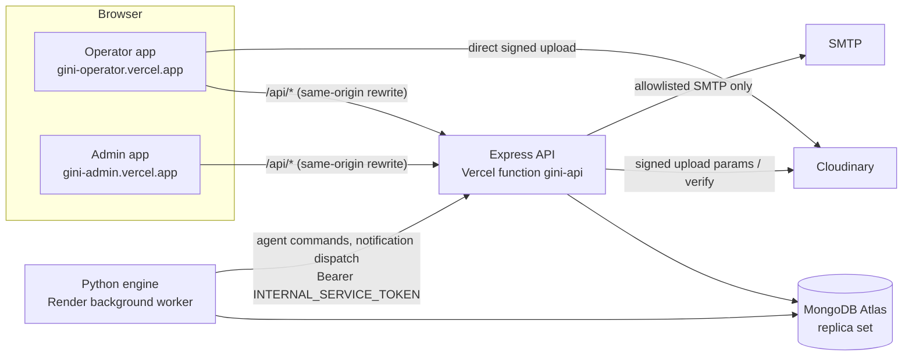

# Deployment: Vercel × 3 + Render worker + MongoDB Atlas + Cloudinary + SMTP (capture by default)

The configuration is limited to GiNi's own services; no unrelated payments or bookings configuration exists in any `.env.example`, `vercel.json` or `render.yaml` (checked by grep).

**Status: NOT DEPLOYED (blocked here: no provider credentials, and public deployment was not authorised).** The steps are prepared
and the configuration files are written, but no remote deployment was exercised from this workspace. Run the smoke tests in §6
after deploying, and do not report remote deployment as passed until they have run.

## 0. Runtime versions (decided from the official documentation, checked 2026-10-18)

| Runtime | Decision | Where it is declared | Source |
|---|---|---|---|
| Node.js | **22.x** for all three Vercel projects and local work. Vercel currently offers 24.x (default) and 22.x. Node 20 was deprecated on Vercel on 2026-10-01, so the old `>=20.11 <23` range, the `node:20` Compose images and the "20.x" settings were inconsistent with each other and with the platform. 22.x is the version the build and all test runs used. 24.x is the upgrade path once retested. | `engines.node = "22.x"` in `package.json`, `backend/`, `frontend/` and `admin/`; `.nvmrc`; `compose.yaml` `node:22.22.0-bookworm-slim` | [Vercel: supported Node.js versions](https://vercel.com/docs/functions/runtimes/node-js/node-js-versions); [Node.js 20 deprecation](https://vercel.com/changelog/node-js-20-is-being-deprecated) |
| Python (engine on Render) | **3.13** in the Docker image (`python:3.13-slim`). With the Docker runtime the image decides the version. Render's `PYTHON_VERSION` / `.python-version` apply to native Python services (new services default to 3.14.x), and `backend/python_engine/.python-version` pins 3.13 for that case. | `python_engine/Dockerfile`, `.python-version`, `compose.yaml` | [Render: setting your Python version](https://render.com/docs/python-version) |
| MongoDB | Atlas replica set; Compose uses `mongo:7.0.14` | `compose.yaml` | — |

## Lockfiles

**BLOCKED in the build workspace.** The npm and PyPI registries are not reachable there, so `package-lock.json` cannot be generated
honestly. The dependencies are pinned to exact versions instead:

- Node: express 4.21.2, mongodb 6.12.0, nodemailer 6.9.16, react 19.1.0, vite 6.3.5, playwright 1.49.1.
- Python: pymongo 4.10.1, dnspython 2.7.0, pytest 8.3.4, openpyxl 3.1.5.

The tests ran with these exact library versions, built from their official GitHub release tags (IMPLEMENTATION_STATUS.md §1).
Generate and commit the lockfiles on a connected machine **before** deploying:

```powershell
cd backend;  npm install; git add package-lock.json
cd ..\frontend; npm install; git add package-lock.json
cd ..\admin;    npm install; git add package-lock.json
cd ..\backend\python_engine; py -3.13 -m venv .venv; .\.venv\Scripts\Activate.ps1; pip install -r requirements.txt; pip freeze > requirements.lock.txt
```

Vercel then installs from the lockfile (`npm ci`). `npm ci` refuses to run without a committed lockfile, so this step is
required, not optional.

**External review result (2026-10-19, reported by the reviewer, not re-run here).** In an environment with registry access:

- the published npm dependencies installed;
- `vite build` succeeded for both the operator and admin apps;
- the database-free Node and Python tests passed.

That review used Node 24 and Python 3.12. The registry and `vite build` blockers are therefore specific to this build workspace,
not defects in the application. The exact project runtimes (Node 22, Python 3.13) still need the same check, and the lockfiles
still have to be generated and committed.



## 1. MongoDB Atlas

1. Create a project and a cluster. **Size:** the full seed is ~520 MB of JSON (≈ 180 MB of it `ref_*` reference
   analytics) plus indexes and session data; plan for **at least 1 GB of storage** — the free M0 tier (512 MB) is too
   small. Check current Atlas tiers at deploy time. Any Atlas tier is a replica set, which transactions require.
2. Database Access → add a user with `readWrite` on the demo database only.
3. Network Access → allow the egress of Vercel and Render. Their egress IPs are not fixed on standard plans; for a
   demo, `0.0.0.0/0` with a strong password is the usual choice — record that decision.
4. Copy the SRV connection string (`mongodb+srv://…`). It goes into the API project, the Render worker and your
   seeding shell — never into git.

## 2. Seed (explicit, from your machine)

Follow `QUICKSTART.md` §2 (`import_workflow.py verify`, then `seed`, then `setup_accounts.py`) with `MONGODB_URI` pointing at
Atlas. Run the `gate` mode against a separate disposable database first (DATA_IMPORT_REPORT.md). Then create indexes and the
default session:

```bash
cd backend
MONGODB_URI="mongodb+srv://…" MONGODB_DB_NAME=gini_demo node scripts/ensure-indexes.js
MONGODB_URI="mongodb+srv://…" MONGODB_DB_NAME=gini_demo node scripts/create-default-session.js
```

The engine initialises the session once it runs (step 4). Re-running the seed inserts nothing and never overwrites
application activity. The workflow exits 1 if the database and the workbooks disagree, and 2 if a workbook is missing or changed.

## 3. Vercel — three projects from one repository

| Project | Root Directory | Framework | Build | Output | Node |
|---|---|---|---|---|---|
| `gini-api` | `backend` | Other | (none) | (none) | 22.x (from `engines`) |
| `gini-operator` | `frontend` | Vite | `npm run build` (runs `prebuild` = deploy check) | `dist` | 22.x |
| `gini-admin` | `admin` | Vite | `npm run build` (runs `prebuild` = deploy check) | `dist` | 22.x |

`backend/vercel.json` routes `/api/*` to `api/index.js` (Express) with a 30 s limit. Each app's `vercel.json`
rewrites `/api/:path*` to the API project and falls back to `index.html` for SPA deep links.

1. Create `gini-api` first; set its variables (`backend/docs/ENVIRONMENT.md`, API table) for **Production**; deploy; note the URL.
2. Point both apps at it (Vercel does not interpolate variables in `vercel.json`):
   ```bash
   cd frontend && npm run configure:vercel -- https://gini-api.vercel.app
   cd ../admin  && npm run configure:vercel -- https://gini-api.vercel.app
   ```
   Commit the two `vercel.json` changes. **Deploy gate:** each app's `prebuild` runs `scripts/check-deploy.mjs`. On Vercel
   (`VERCEL=1`) the build **fails** while the `/api` rewrite still points to the `YOUR-GINI-API` placeholder or to a non-https
   origin, or when a `VITE_*` variable looks like a secret. Check locally with `npm run check:deploy`.
3. Create `gini-operator` and `gini-admin` (variables: `VITE_APP_KIND=operator|admin`, `VITE_API_BASE_URL=/api`).
4. Set `FRONTEND_URL` and `ADMIN_URL` on `gini-api` to the two **exact** production origins and redeploy the API.
   Preview deployments get other origins; add them to `EXTRA_ALLOWED_ORIGINS` only if you test previews.

Why same-origin rewrites: the browser only ever talks to its own app origin, so the session cookie is host-only,
`SameSite=Lax`, `HttpOnly` and `Secure`, and no CORS is needed. The API additionally checks the exact `Origin`, a CSRF
token header and the app kind on every write.

## 4. Render — engine worker

`render.yaml` (repository root) defines `gini-engine` as a Docker **background worker** (build context `backend/`,
Dockerfile `python_engine/Dockerfile`). Background workers are a paid instance type; check current plans.

1. Render → New → Blueprint → select the repository (or create a Background Worker manually with the same settings).
2. Enter the `sync: false` values: `MONGODB_URI`, `NODE_API_INTERNAL_URL=https://gini-api.vercel.app`,
   `INTERNAL_SERVICE_TOKEN` (identical to the API's).
3. Deploy. Logs show `engine <id> started`, then `calendar continuation …`, then session activity.

Only **one** worker instance is needed; more are safe (session leases and fenced jobs prevent double advancement —
tested in `python_engine/tests_integration`), but they do not make a single session faster.

## 5. Cloudinary and SMTP

* Cloudinary: copy cloud name, API key and API secret into `gini-api`; set `EVIDENCE_STORAGE_MODE=cloudinary`. The
  browser receives a short-lived signature for one upload into `gini-demo/evidence/<session>/…` as an authenticated asset; the API verifies the
  completed asset (size, format, dimensions) with Cloudinary before an inspection may use it. Delivery goes through the
  API (`/evidence/{id}/view`) after a role check.
* Email: keep `EMAIL_MODE=capture` for the demo (messages appear under Administration → Notifications and Alerts →
  Notifications). For live SMTP set `EMAIL_MODE=smtp`, the SMTP variables and `ALERT_EMAIL_ALLOWLIST`; only allowlisted
  addresses are ever emailed. SMTP cannot guarantee exactly-once delivery after an ambiguous acceptance; each message
  carries a stable Message-ID/dedup key and the outbox records `PENDING / CLAIMED / CAPTURED (capture mode) / SENT / RETRY / FAILED / UNCERTAIN` (an expired claim becomes UNCERTAIN and is never resent automatically).

## 6. Smoke tests after deployment (AT24)

Run in order; record date, URLs and results. `curl` examples use bash.

| # | Check | How | Expected |
|---|---|---|---|
| 1 | API liveness | `curl -s https://gini-api.vercel.app/api/health` | `{"ok":true,…}` |
| 2 | API readiness | `curl -s https://gini-api.vercel.app/api/ready` | `ready: true`, `database: "OK"`, email mode, evidence mode |
| 3 | Rewrite | `curl -s https://gini-operator.vercel.app/api/health` and the admin URL | same JSON via each app origin |
| 4 | SPA deep links | open `https://gini-admin.vercel.app/workforce` and `https://gini-operator.vercel.app/progress` directly | app loads (sign-in first), no 404 |
| 5 | Exact origin | `curl -s -X POST https://gini-api.vercel.app/api/auth/login -H 'origin: https://evil.example' -H 'content-type: application/json' -d '{}'` | 403 |
| 6 | Cookies | sign in to the operator app; DevTools → Application → Cookies | host-only cookie for the operator origin, `HttpOnly`, `Secure`, `SameSite=Lax`; none for the API host |
| 7 | CSRF | replay a captured write request without `x-csrf-token` | 403 |
| 8 | App binding | operator-app cookie used against the admin app | not signed in |
| 9 | Engine heartbeat | Admin → Administration → Jobs & engine | engine `RUNNING`, heartbeat < 15 s; header shows "Analytics up to date" |
| 10 | Session advances | Admin → Play at ×10 for one minute → Pause | simulated time moved; events appear; forecast "computed" time updates |
| 11 | Signed upload | operator inspection → Upload photo | badge goes Uploading → Verifying → Verified; asset visible in Cloudinary under `gini-demo/evidence/` |
| 12 | Notification capture | scenario console → Break down equipment | M11 alert FIRING; exactly one captured notification (`TRANSPORT: nodemailer jsonTransport (capture)`) |
| 12b | Live flags | `npm run test:flags` with `API_URL`/`ADMIN_URL` set to the deployed URLs and a disposable session | F1–F6 lifecycle PASS |
| 12c | SMTP (only with explicit authorisation and allowlisted test recipients) | `EMAIL_MODE=smtp` on a test deployment; trigger one alert | SENT with the dedup header; no non-allowlisted recipient |
| 13 | Render env | Render → gini-engine → Environment | `APP_ENV=production`, token set, API URL correct |
| 14 | Latency | `node scripts/measure-latency.js --iterations 10 --out docs/test-results/latency-deployed.json` with `API_URL` = the API URL | record against the ≤ 5 s / ≤ 15 s targets |

## 7. Operations

* **Logs:** API → Vercel project → Logs (one line per error with its `correlationId`; secrets and PINs are never
  logged). Engine → Render service → Logs. Database → Atlas → Metrics / Query Profiler. In-app: Administration → Jobs &
  engine (jobs, dead letters, engine heartbeats), Audit, Notifications.
* **Reset a demo session:** Administration → Simulation → Reset (type `RESET <session id>` to confirm). Only that
  session's simulation records are deleted and re-initialised from the checkpoint; seeded data, accounts and other
  sessions are untouched.
* **Reclaim storage:** archived sessions keep their records until purged:
  `node scripts/purge-archived-sessions.js` (dry run) then `--older-than-days 7 --yes`.
* **Backup:** Atlas continuous backup / snapshots on paid tiers; or `mongodump --uri "$MONGODB_URI" --db gini_demo`.
  The seed is reproducible from the workbooks; application activity can be exported with
  `seed/export_app_activity.py`.
* **Rotate secrets:** change `SESSION_SECRET` (signs everyone out), `INTERNAL_SERVICE_TOKEN` (API and Render together),
  Cloudinary/SMTP credentials in the dashboards; redeploy.

## 8. Troubleshooting

| Symptom | Likely cause | Fix |
|---|---|---|
| `/api/ready` → `database unavailable` / timeouts | Atlas network access, wrong user/password, SRV DNS blocked | allow the egress in Atlas Network Access; test with `mongosh "$MONGODB_URI"`; keep `dnspython` installed for the engine |
| Engine log `No module named pymongo` | dependencies not installed in the image/venv | `pip install -r python_engine/requirements.txt`; on Render, redeploy the Docker image |
| Engine log `CONFIG ERROR: …` and exit code 2 | missing `MONGODB_URI`, `NODE_API_INTERNAL_URL` or `INTERNAL_SERVICE_TOKEN` in production | set them on Render |
| Engine log `command endpoint unavailable (401)` | token differs between API and engine | copy the same `INTERNAL_SERVICE_TOKEN` to both and redeploy both |
| Header "Engine offline - analytics may be stale" | no engine heartbeat for 60 s | check Render; observed state stays live, analytics resume when it restarts (no lost events) |
| Header "Waiting for engine" | engine alive but this session not yet leased (just created/reset) | wait a few seconds |
| Sign-in "PIN not accepted" for a known worker | PIN typed without leading zeros, or a different `DEMO_PIN_SEED` was used at seed time | PINs are text (`004211` ≠ `4211`); derive with `setup_accounts.py --show-pin-for W0001` using the seed's `DEMO_PIN_SEED`; or reset the PIN in Administration → Workers |
| Sign-in 429 | too many failed attempts (10 per login, 50 per IP in 15 min) | wait the window or change `LOGIN_RATE_*` |
| Writes fail with 403 "Origin not allowed" / "Missing or invalid CSRF token" | `FRONTEND_URL`/`ADMIN_URL` not the exact origin (scheme, host, no trailing slash), or the app is called on another domain | fix the variables and redeploy the API |
| Cookies missing after sign-in | app calls the API host directly instead of `/api` | keep `VITE_API_BASE_URL=/api` and the rewrite |
| Photo stuck at "Verifying" or Cloudinary rejects the upload | wrong Cloudinary secret/key pair, or clock skew | re-copy credentials; the signature is valid for a short window |
| Notifications "uncertain"/"retry" | SMTP timeout after acceptance | expected edge; check provider logs; never resend blindly — the dedup key prevents duplicates |
| Vercel 504 on a long request | function limit (30 s) | heavy work runs in the engine as jobs; retry; check Atlas performance |
