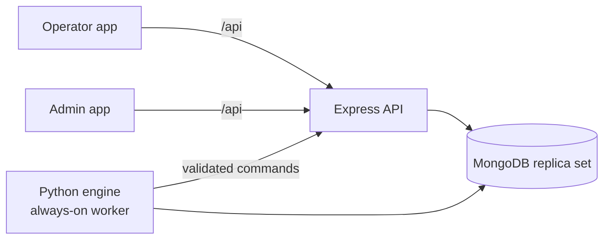

# Start here

This is the unified fresh-factory delivery. Read **START_HERE_UNIFIED.md**, **UNIFIED_CHANGE_REPORT.md** and **UNIFIED_TEST_REPORT.md** first. The application uses the original shared manufacturing model and Python engine; it has no separate FactoryOps database.

---

# GiNi Manufacturing — transformer-tank production demonstration

A working MERN + Python demonstration of shift visibility, quality-controlled tank flow, variance flags, deadline
risk and recovery for a Siemens Energy transformer-tank use case. **All data is synthetic**: fictional people and
plant, not connected to any factory, not Siemens-approved, not production software.

## Fresh Factory (empty database for team testing)

Besides the synthetic demonstration, the app can run an **empty factory** in its own database: no workers, orders,
tanks or history - an administrator configures everything in the admin app and the team works in real time.
Start with `FRESH_FACTORY_SETUP.md`, then `ADMIN_FIRST_RUN_GUIDE.md` and `TEAM_TEST_WALKTHROUGH.md`
(Windows: `gini-fresh-setup.ps1` once, then `gini-3-start.ps1`). The synthetic demo database is not modified.

## What is in this repository

| Folder | What | Runs on |
|---|---|---|
| `frontend/` | **Operator app** (Vite + React JSX): employee-ID + PIN sign-in, current task, milestones, pause/help/handover, queue, mandatory post-task inspection with camera/upload photo evidence, incoming-defect report, progress and points ledger | Vercel project 1 |
| `admin/` | **Supervisor / admin app**: plant overview, orders and batches with tank passports, work centres, workforce, quality and rework, alerts, recovery, verification, materials and equipment, administration (workers, sessions and clock, scenario console, rule settings, jobs, notifications, import/reconciliation, audit) | Vercel project 2 |
| `backend/` | **Express API** (`src/`, Vercel function `api/index.js`), **Python engine worker** (`python_engine/`), seed tooling (`seed/`), seed workbook (`data/final/`), contracts, configuration, tests, docs | Vercel project 3 + Render worker |

* **Express** owns authentication, permissions and every validated state transition (one command path for people and
  for the simulated plant agents).
* **Python** owns every derived calculation: checkpoint reduction, background plant agents, labour metrics, route
  forecast (discrete-event simulation), cutoff bands, variance rules M01–M13 and flags F1–F6, alert lifecycle and
  notification outbox, points ledger, recovery options with donor checks, and action verification.
* Two modes: **synthetic live replay** (read-only history at any time) and **interactive branches** forked from
  checkpoint `CK-20261015-1055` on `RUN-BASE`, with a shared simulation clock (pause, ×1…×120), human-control leases,
  a scenario console that injects causes (never flags) and reset-to-checkpoint.

## Start here

| Document | For |
|---|---|
| [`QUICKSTART.md`](QUICKSTART.md) | running locally (Windows PowerShell first, macOS/Linux, Docker Compose) |
| [`ACCEPTANCE_WALKTHROUGH.md`](ACCEPTANCE_WALKTHROUGH.md) | the reviewer's path from an existing worker to verification, with expected results |
| [`FIX_REPORT.md`](FIX_REPORT.md) | every audit finding: confirmed?, root cause, change, test, limitation |
| [`IMPLEMENTATION_STATUS.md`](IMPLEMENTATION_STATUS.md) | requirement → code → test → status |
| [`TEST_RESULTS.md`](TEST_RESULTS.md) | environment, dataset checksums, versions, database kind, every result and its evidence |
| [`DATA_IMPORT_REPORT.md`](DATA_IMPORT_REPORT.md) | the three Final workbooks: checksums, validation, seed/reseed, preservation, drift |
| [`DATABASE_PERSISTENCE_MAP.md`](DATABASE_PERSISTENCE_MAP.md) | every UI action → command → collections/events → derived values → screens; audit metadata |
| [`TANK_PASSPORT_FIELD_MAP.md`](TANK_PASSPORT_FIELD_MAP.md) | passport field → source → missing-data behaviour → permission |
| [`ENGINE_RULES.md`](ENGINE_RULES.md) | points, the six flags, cutoff bands, deadline scheduling, recovery |
| [`DEPLOYMENT.md`](DEPLOYMENT.md) | runtime versions, lockfiles, Vercel × 3, Render, Atlas, Cloudinary, SMTP; smoke tests |
| [`ACCEPTANCE_WALKTHROUGH.md`](ACCEPTANCE_WALKTHROUGH.md) | 18-step reviewer walkthrough with expected results and the matching automated test |
| [`docs/screenshots/`](docs/screenshots) | screenshots captured by the e2e and flag tests (operator, inspection, worker creation, passport, F1–F6 firing) |
| [`backend/docs/`](backend/docs) | environment variables, permissions, assumptions, data model, formulas, OpenAPI, original source audit |

## Status in one paragraph

All three Final workbooks are integrated through a reproducible, validated import (0 missing of 3,474,855 references). The app
runs on the real Express / MongoDB driver / Nodemailer / PyMongo libraries.

The second review's findings are fixed and tested (FIX_REPORT.md §Second review):

- deadlines are evaluated to the second;
- administrative actions are atomic with their audit records;
- rework standards need a named approval;
- scoring exceptions are an explicit, confirmed policy;
- the passport explains every state.

In the build workspace every test ran against a **test-substitute database** speaking the MongoDB wire protocol, because no
MongoDB server, package registry or provider account was reachable there. **Before acceptance**:

1. run the import gate and the test suites on a disposable real MongoDB replica set;
2. generate the lockfiles;
3. deploy;
4. run the smoke tests.

TEST_RESULTS.md lists what passed, failed or was blocked.

No secret values are included. `.env.example` files contain placeholders only.
