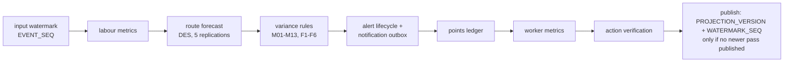
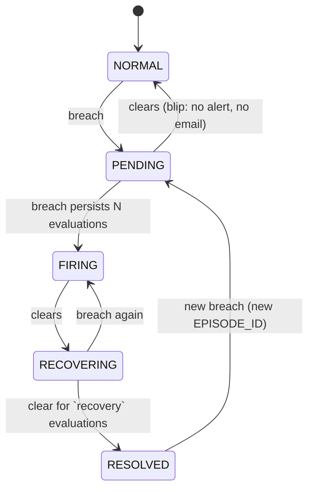

# Calculation registry and formulas

Ownership: **Python** (`python_engine/gini_engine/`) owns every derived manufacturing calculation — labour metrics,
forecasts, variance rules, alert lifecycle, points ledger, recovery options and action verification. **Express** owns
authorisation and the validated command transitions (what may happen and who may do it). The browser only displays.
One formula has one implementation; nothing is recomputed in the UI.

Every calculation pass runs in this order (`calc.py`) and publishes one coherent `PROJECTION_VERSION`:

Readers select projections with `PROJECTION_VERSION <= session.PROJECTION_VERSION`, so a screen never mixes two
calculation versions and a delayed job can never overwrite a newer projection (fenced publish).

## 1. Labour and production metrics (`metrics.py`)

| Quantity | Formula | Guards |
|---|---|---|
| Actual labour minutes | Σ non-overlapping DIRECT/REWORK participation intervals per worker. 3 people × 30 min = **90 labour-min** (not 90 elapsed minutes, not 3 tanks) | breaks, external blocks, transfers and unattended cure are excluded |
| Earned standard minutes | Σ `STANDARD_LABOR_MIN` of labour attempts **completed** in the window | completion-bias guard: only finished attempts on both sides |
| Labour efficiency % | earned standard min ÷ eligible actual labour min of the same completed attempts × 100 | zero denominator → undefined with reason (never 0 % or 100 %) |
| Productivity variance | efficiency − 100 percentage points (target = 100 % of standard) | |
| Labour budget gap | eligible actual min − earned standard min | |
| Remaining standard work | standard labour of queued tanks' next operation + (1 − progress) × standard labour of in-process attempts | by operation and skill, never raw tank counts across unlike products |
| Available labour | unique qualified clocked-in workers × remaining productive minutes to shift end | breaks, other assignments, travel excluded; a person counts once |
| First-attempt fail rate | failed first-attempt gate inspections ÷ first-attempt gate inspections (window) | scrap rate = scrapped ÷ tanks inspected |
| Order shortfall | max(0, required good qty − forecast accepted good qty by the deadline) | |

Crew size uses `CREW_CAPACITY_RULES` (minimum / standard / maximum crew and elapsed time per crew size); adding people
beyond the standard crew does not shorten the operation linearly. Throughput is never multiplied by crew count after
summing worker-hours (the legacy `× RESOURCES` double count is removed).

## 2. Cutoff bands (`forecast.classify`)

> Exact boundary examples and deadline-aware scheduling (`calc.next_boundaries`): `ENGINE_RULES.md` §1–2 at the project root.

Deadline basis: **ROUTE_COMPLETE** of the required good quantity (not shipment ready; a logistics offset of 0 min is
configurable). Safety buffer: `SAFETY_BUFFER_MINUTES` = 10.

| Band | Condition |
|---|---|
| GREEN | forecast ready ≤ cutoff − buffer (inclusive: 14:20 with a 14:30 cutoff) |
| AMBER | cutoff − buffer < forecast ready ≤ cutoff (14:30:00 is AMBER) |
| RED | forecast ready > cutoff (14:30:01 is RED), **or** a known quantity shortfall, **or** the cutoff elapsed without the output |
| UNKNOWN | readiness cannot be estimated (no due time, no evidence) — never converted to on-time |
| COMPLETE | output finished; keeps its actual result (GREEN/AMBER/RED) |

The engine re-evaluates every 5 simulated minutes even without new events, so a deadline that passes silently turns RED.
Tests: `python_engine/tests/test_cutoff.py` (buffer deadline, cutoff, one second late, unknown, shortfall, overnight shift,
other timezone).

## 3. Forecast (`forecast.py`)

Resource-constrained discrete-event simulation of the session's **current** state at 5-minute resolution, five
seeded replications (median reported, min–max shown as a scenario range — not a calibrated probability). Modelled:
route precedence per product, DR-1.0 ready queues, workstation capacity, equipment outages until recorded or
MTTR-estimated recovery, qualified crews (min/standard/max), worker availability from attendance plus rosters known at
the fork (and the synthetic calendar continuation), planned breaks per work-centre calendar, unattended cure,
independent inspection capacity, transfers, material stock with open requests and the replenishment policy (re-order
below 75 % of a day's use, 1.5 days ordered, promised in 90 min; a recorded supply interruption delays it), holds with
the versioned disposition matrix, rework/reinspection loops, planned batch releases and replacement tanks. Gate failures
are drawn from first-attempt fail rates known at the fork.

It never reads recorded future history. Output per order line: forecast ready time and range, good-by-due and range,
slack, band with reason, and limiting constraints (e.g. `STATIONS_BUSY @ WC3`, `QUALIFIED_LABOUR @ WC2`, `MATERIAL`,
`EQUIPMENT_DOWN`, `INSPECTOR`, `BREAK`). Per work centre: load vs qualified labour, status, predicted run-out of work.

> The six requested flags (F1–F6), their configuration (rules 1.1.0) and the live test procedure are in `ENGINE_RULES.md` §3 at the project root.

## 4. Variance rules and flags (`variance.py`, configuration `config/rules.json`, editable as new versions in Administration → Rule settings)

Evaluation every 5 simulated minutes. Baselines are time-of-shift slots (60 min) over 5 days of history known at the
fork. Zero baseline uses the absolute threshold or `NEW_BACKLOG` (never infinity). Missing evidence gives
`NO_DATA` / `INSUFFICIENT_DATA`, which neither breaches nor resolves.

| Rule | Name | Scope | Formula | Threshold | Min. samples | Persist / recover | Notify | Severity |
|---|---|---|---|---|---|---|---|---|
| M01 | Low labour efficiency | WORK_CENTER | earned eligible standard labour min / eligible actual labour min x 100 over the window | `{"op": "<=", "value": 85, "critical": 70}` | `{"completed_operations": 3, "actual_labor_min": 120}` | 2 / 2 | yes | MEDIUM; HIGH at or below critical |
| M02 | Earned-work gap against plan | WORK_CENTER | eligible actual labour min - earned standard min (shift to date); basis = routing standard at actual crew | `{"op": ">=", "value": 120, "pct_of_earned": 15}` | `{"completed_operations": 3}` | 2 / 2 | no | MEDIUM |
| M03 | Work-centre performance classification | WORK_CENTER | classification of M01 efficiency | `{"LOW": "< 85", "ON_TARGET": "85..110", "OVER_TARGET": "> 110"}` | `{"completed_operations": 3}` | — / — | no | — |
| M04 | High comparable backlog / queue growth | WORK_CENTER | standard labour minutes of tanks queued at the work centre vs same-time-of-shift baseline; growth between evaluations | `{"op": ">=", "pct_over_baseline": 30, "min_abs_std_min": 300, "growth_pct": 15, "min_growth_std_min": 100}` | `{"baseline_days": 3}` | 2 / 2 | no | MEDIUM |
| M05 | Qualified labour-capacity imbalance / staffing gap | WORK_CENTER | remaining standard labour (queued + in-process remaining) - unique qualified remaining productive minutes before shift end | `{"op": ">=", "value": 60}` | `—` | 2 / 2 | yes | MEDIUM; HIGH if staffing gap >= 2 |
| M06 | Excess rework / scrap rate | GATE | failed first-attempt inspections / first-attempt inspections at the gate (window); scrap rate = scrapped / tanks inspected | `{"op": ">=", "fail_rate_pct": 10, "min_pp_over_baseline": 5, "scrap_count": 1}` | `{"inspections": 8}` | 1 / 2 | yes | MEDIUM; HIGH for any scrap |
| M07 | Productivity-quality conflict (correlation, not blame) | WORK_CENTER | efficiency improves >= 10 pp while gate fail rate rises >= 40% relative between consecutive 120-min windows | `{"prod_pp": 10, "quality_rel_pct": 40}` | `{"inspections": 6, "completed_operations": 3}` | 1 / 2 | no | LOW |
| M08 | Workload surge | PLANT | standard labour minutes released into WC1 in the last 120 min vs same-slot baseline | `{"pct_over_baseline": 30, "min_abs_std_min": 600}` | `{"baseline_days": 3}` | 1 / 2 | no | LOW |
| M09 | ETC / deadline risk and buffer erosion | ORDER_LINE | GREEN forecast <= cutoff - buffer; AMBER <= cutoff; RED > cutoff or quantity shortfall; UNKNOWN when not estimable | `{"fire_on": ["RED"], "pending_on": ["AMBER"]}` | `—` | 1 / 1 | yes | HIGH for RED |
| M10 | Upstream starvation / downstream blocking | WORK_CENTER | qualified crew present and stations free but no released tank available (starved), or finished tanks blocked by a full downstream queue | `{"min_minutes": 20}` | `—` | 1 / 2 | no | MEDIUM |
| M11 | Equipment / material interruption | WORKSTATION | equipment breakdown open, or operation blocked by material shortage | `{"any": true}` | `—` | 1 / 1 | yes | MEDIUM; HIGH if > 60 min |
| M12 | Missing qualification / minimum crew | WORK_CENTER | ready work exists but qualified available (incl. valid qualification at sim time) < minimum crew | `{"any": true}` | `—` | 2 / 2 | yes | MEDIUM |
| M13 | Stale telemetry / assignment delay | WORKER | stale: no device/app signal > stale_after_min while a task is active (reported as last-known, never idle); assignment delay: ready work + eligible available worker unassigned > delay_min | `{"stale_after_min": 15, "assignment_delay_min": 20}` | `—` | 2 / 1 | no | LOW |
| F1 | Stalled Active Assignment | OPERATION | genuinely started task (WORKING) with fresh activity evidence but no milestone/progress beyond expected interval x factor; excludes cure, breaks, authorised pauses, external holds | `{"factor": 1.5, "min_excess_min": 20}` | `—` | 2 / 2 | yes | MEDIUM; HIGH if factor >= 2 |
| F2 | Regional Workload Imbalance | AREA | remaining standard labour by area and skill / uniquely counted qualified remaining capacity; fire when one area ratio > 1.3 while another < 0.7 with transferable qualified people | `{"high_ratio": 1.3, "low_ratio": 0.7}` | `{"qualified_people": 2}` | 2 / 2 | yes | MEDIUM |
| F3 | Material Velocity Anomaly | MATERIAL | material issues per productive WC1 hour vs contextual baseline (same product mix, time of shift); zero demand is not a fault | `{"rel_pct": 50, "min_abs": 2}` | `{"baseline_days": 3, "productive_hours": 1}` | 2 / 2 | no | LOW |
| F4 | Location Velocity Anomaly | WORKSTATION | tank dwell at a workstation/buffer vs time-of-shift baseline; distinguishes no supply (empty) from slow processing (occupied, slow) | `{"rel_pct": 50, "min_abs_min": 30}` | `{"baseline_visits": 5}` | 2 / 2 | no | LOW |
| F5 | Congestion | WORK_CENTER | finite queue occupancy vs configured physical capacity (WORK_CENTER_MASTER.QUEUE_CAPACITY_UNITS) with persistence, plus blocked arrivals; without capacity no congestion is claimed | `{"occupancy_pct": 85}` | `—` | 3 / 2 | yes | MEDIUM; HIGH at 100% with blocked arrivals |
| F6 | Replenishment Delay | MATERIAL_REQUEST | request outstanding quantity past NEED_BY_AT (partial deliveries reduce outstanding; cancelled requests excluded); linked to material-related waiting | `{"min_minutes": 10}` | `—` | 1 / 1 | yes | MEDIUM; HIGH if an operation is waiting |

## 5. Alert lifecycle (`alerts.py`)

Workflow (people only): `UNACKNOWLEDGED → ACKNOWLEDGED → IN_PROGRESS → CLOSED`. Acknowledging never resolves; closing an
active condition needs an explicit force with a note. `ALERT_ID = AL-<rule>-<entity>` is stable; each breach after
resolution starts a new episode. Escalation: HIGH severity unacknowledged for 30 min. Notifications: one outbox item per
`<session>|<alert>|<episode>|<transition>` (unique key) for FIRING / ESCALATED / RESOLVED of notifying rules, suppressed in
replay, at speed ≥ ×30, inside the cooldown and on a session's first pass (conditions already present at the fork).

## 6. Recovery options (`recovery.py`)

Generated from the forecast's limiting constraints for an at-risk line, each simulated through the same DES
(3 replications) and compared with the no-action baseline:

| Family | Feasibility checks |
|---|---|
| Qualified transfer | recipient qualified and valid at arrival time; present for a minimum useful duration; not human-controlled; donor keeps its minimum crew; donor queue still covered; travel + handover time from `TRANSFER_RULES` |
| Overtime | clocked-in operators at the constrained work centre; demo policy caps 120 min per person; supervisor approval; does not move the customer due time |
| Replacement | a scrapped tank exists on the line and no replacement yet |
| Resequence | permitted by the dispatch rule; tank queued |
| Material expedite | open shortage; cannot beat a recorded supply interruption |
| Maintenance expedite | advisory only (no command) |
| Combinations | replacement + transfer, transfer + overtime, resequence + transfer |

**Donor impact**: every option re-forecasts all lines; an option that pushes another line to RED is rejected as
source-damaging. Infeasible options stay visible with the rejection reason. Preview never changes state.
Proposals revalidate on approval and on start; any new event since the forecast makes the approval stale.

## 7. Verification (`verify.py`)

For each started/completed action: planned vs actual travel and handover per transfer, forecast before and after the
action (immutable copies) vs the observed result once the due time passed or the line completed (otherwise the latest
forecast, labelled PROVISIONAL), forecast error in minutes, and lessons proposed as versioned estimate updates for a
named owner — standards never change silently.

## 8. Points (`points.py`, policy `config/points_policy.json`)

> **Current rules (RULE_VERSION 2.0, v3 repair):** fractional TV1 splits, exact subject keys, re-evaluation with linked reversals, pending allocation and responsibility validation are specified in `ENGINE_RULES.md` at the project root. That document takes precedence over this section where they differ.

| Rule | Points | Basis |
|---|---|---|
| PTS-TV1 | +1 per minute saved, −1 per minute exceeded | `STANDARD_ELIGIBLE_MINUTES − ACTUAL_ELIGIBLE_MINUTES` per gate-released labour attempt; crew shares by eligible minutes (the allowance is split, never duplicated); inspections not time-scored |
| PTS-NR3 | +3 per work order | route-complete with no rework, scrap, FAIL hold or downstream defect on any tank |
| PTS-OF2 | +2 per work order | defect caught and corrected at its origin station; exclusive with NR3; first-stage scrap never qualifies |
| PTS-DD4 | −4 per distinct downstream defect | only after a named reviewer confirms a WORKER cause; pending investigations, equipment, material, supplier and process causes never deduct; a changed confirmation posts an inverse reversal |

Allocation (provisional, awaiting business confirmation): work-order awards proportional to eligible contribution
minutes (no denominator → PENDING); 2-decimal precision with largest-remainder residual (ties by `WORKER_ID`), so
allocations sum exactly. Business key `AWARD_KEY + WORKER_ID` is unique: retries, restarts and repeated passes never
duplicate points. Every displayed total equals history ledger (known at the fork) + session ledger (known at simulated
now). Tests: `python_engine/tests/test_points.py`, `tests/integration/acceptance.test.js` (AT9).
